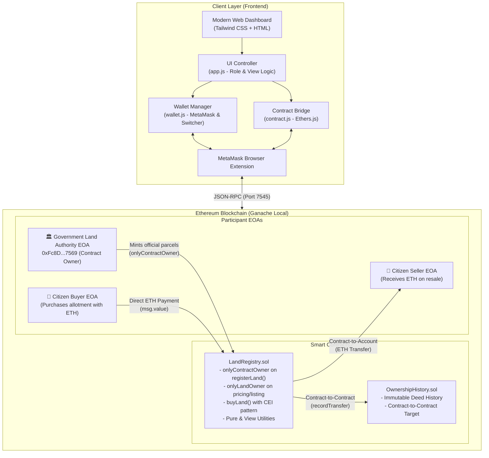
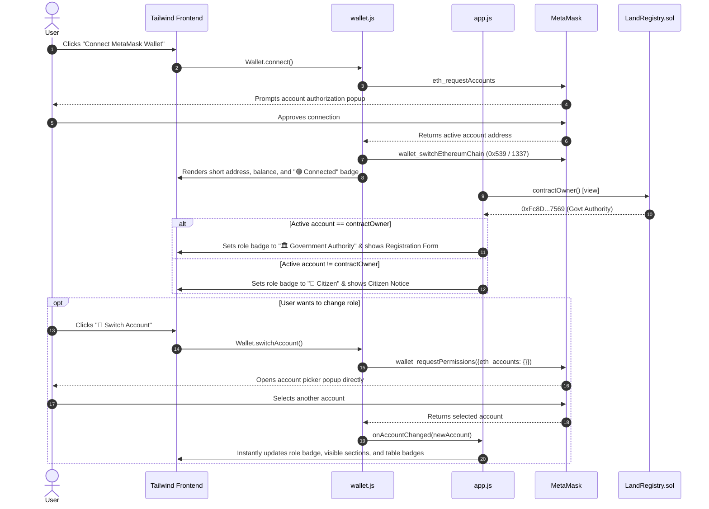
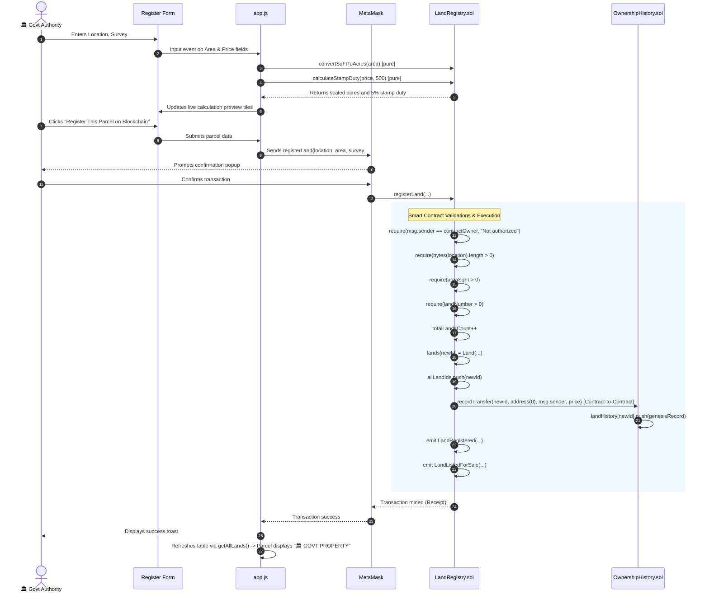
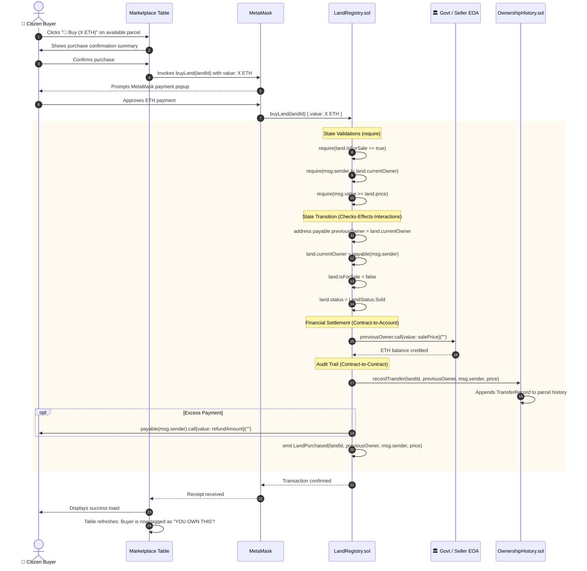
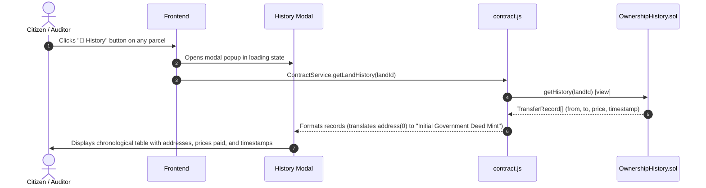

# 📖 SafeLand DApp - Architecture & Complete Workflow Guide

This document provides a comprehensive, step-by-step breakdown of how the **SafeLand Decentralized Registry** operates, from smart contract logic and role-based access controls to the user interface.

---

## 🏛️ System Architecture Diagram

---

## 👥 Role-Based Access Control Architecture

The platform partitions user actions across two distinct roles:

| Feature / Operation | 🏛️ Government Authority (`0xFc8D...7569`) | 👤 Citizen (`0x271c...74B0`, etc.) |
|---|---|---|
| **Connect Wallet** | Shows `🏛️ Government Authority` badge | Shows `👤 Citizen` badge |
| **Register Land Parcel** | ✅ Allowed (`onlyContractOwner`) | ❌ Reverts with `"Not authorized"` |
| **Registration Form UI** | ✅ Form visible | ❌ Replaced with Citizen Purchase Notice |
| **Buy Government Allotment** | ❌ Reverts (Owner cannot buy own land) | ✅ Allowed with direct ETH payment |
| **List / Delist Owned Land** | ✅ Allowed for lands owned | ✅ Allowed for lands owned |
| **Update Asking Price** | ✅ Allowed for lands owned | ✅ Allowed for lands owned |
| **Deed Transfer History** | ✅ Publicly auditable | ✅ Publicly auditable |
| **Directory Owner Badge** | Displays `🏛️ GOVT PROPERTY` | Displays regular formatted address |

---

## 🔄 End-to-End Workflows

### 1. Wallet Connection & One-Click Account Switching
*(Satisfies Requirement 2: Connect Wallet)*

**Key Highlights:**
- **Zero-Friction Switching**: The dedicated **Switch Account** button calls `wallet_requestPermissions` so users can jump between Government and Citizen profiles without manually opening extension menus.
- **Dynamic Role Badge**: Header reflects the active account's permissions in real-time.

---

### 2. Government Land Registration Workflow
*(Satisfies Requirement 1: Access Control, Requirement 3: Data Op, Requirement 4: Constructor, Requirement 6: Contract-to-Contract, Requirement 7: `require`, Requirement 8: `pure`)*

**Key Highlights:**
- **On-Chain Enforcement**: The `onlyContractOwner` modifier ensures that only the authorized government administrator can mint new parcels.
- **Contract-to-Contract Genesis Deed**: Automatically invokes `OwnershipHistory.recordTransfer(...)` with `from: address(0)`, anchoring an immutable origin deed.

---

### 3. Citizen Land Purchase & Ether Settlement Workflow
*(Satisfies Requirement 6: Contract-to-Account & Contract-to-Contract, Requirement 7: `require`)*

**Key Highlights:**
- **Contract-to-Account**: Ether moves securely from the buyer, through the smart contract, and directly to the seller's Externally Owned Account without escrow lockups.
- **CEI Security Pattern**: All internal ownership and status variables are modified *before* triggering the external Ether call, mitigating reentrancy attacks.

---

### 4. Immutable Historical Deed Audit Trail Workflow
*(Satisfies Requirement 6: Contract-to-Contract Historical Query & Requirement 8: View Function)*

---

## 🛡️ Security & Access Control Reference

| Modifier / Pattern | Contract | Protected Method | Security Mechanism |
|---|---|---|---|
| `onlyContractOwner` | `LandRegistry.sol` | `registerLand()`, `updateHistoryContract()` | `require(msg.sender == contractOwner, "Not authorized: Only contract owner can perform this");` |
| `onlyLandOwner(id)` | `LandRegistry.sol` | `listLandForSale()`, `delistLand()`, `updatePrice()` | `require(lands[_id].currentOwner == msg.sender, "Not authorized: Only the land owner can perform this");` |
| `landExists(id)` | `LandRegistry.sol` | `buyLand()`, `getLand()` | `require(lands[_id].id != 0, "Land parcel does not exist");` |
| `onlyAuthorized` | `OwnershipHistory.sol` | `recordTransfer()` | `require(msg.sender == registryContract \|\| msg.sender == admin);` |
| **Checks-Effects-Interactions (CEI)** | `LandRegistry.sol` | `buyLand()` | Updates owner and status state variables before making external `.call{value: ...}`. |

---

## 🎯 Viva & Presentation Cheat-Sheet

When demonstrating the project, follow this 5-minute walkthrough to cover all requirements:

1. **Show Role-Based Minting (Req 1, 3, 4, 7)**:
   - Connect with Account 0 (`0xFc8D...7569`). Point to the **`🏛️ Government Authority`** badge.
   - Point to line 127 in `LandRegistry.sol` showing the `onlyContractOwner` modifier on `registerLand()`.
   - Register a property: watch the live pure function acreage & stamp duty calculations update in real time.
2. **Show Directory & Govt Badge (Req 5, 8)**:
   - Notice the newly minted property appears in the table with the **`🏛️ GOVT PROPERTY`** badge.
   - Point to `getAllLands()` in `LandRegistry.sol` lines 261–267.
3. **Show Account Switching (Req 2)**:
   - Click **`🔄 Switch Account`** in the top bar. Pick Account 1 (`0x271c...74B0`).
   - The UI automatically updates: role badge switches to **`👤 Citizen`**, the registration form disappears, and the Citizen Purchase Portal notice appears.
4. **Show Purchase & Contract-to-Account (Req 6, 7)**:
   - As Citizen, click **`🛒 Buy`** on the government property.
   - Confirm in MetaMask: Ether transfers to Government Account 0, deed transfers to Citizen Account 1.
   - The parcel now displays **`YOU OWN THIS`** for the citizen.
5. **Show Contract-to-Contract Deed History (Req 6)**:
   - Click **`📜 History`** on the purchased property: show the immutable deed trail from `Initial Government Deed Mint` $\rightarrow$ Citizen purchase with full timestamps.
6. **Show Test Suite (Req 9)**:
   - In terminal, run `npx truffle test` and demonstrate **15 passing tests (100% green)**.
