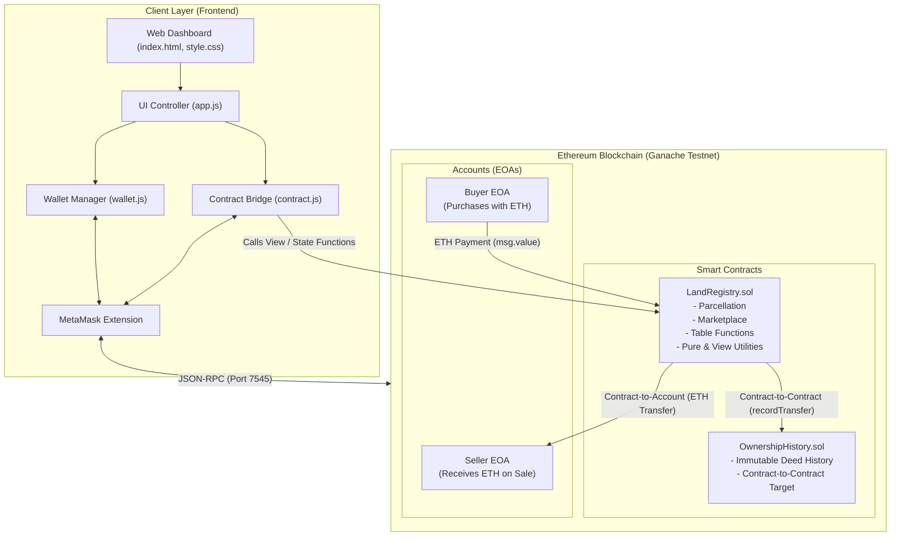
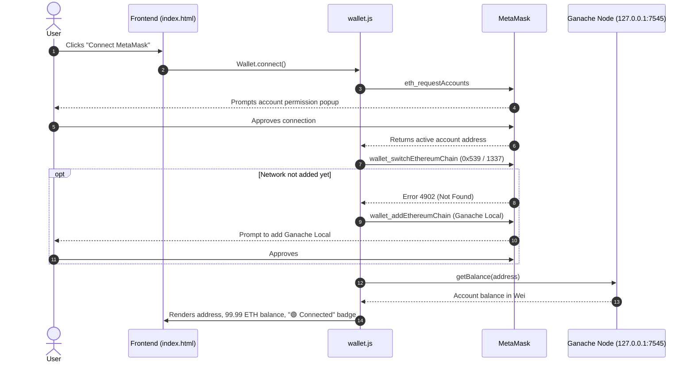
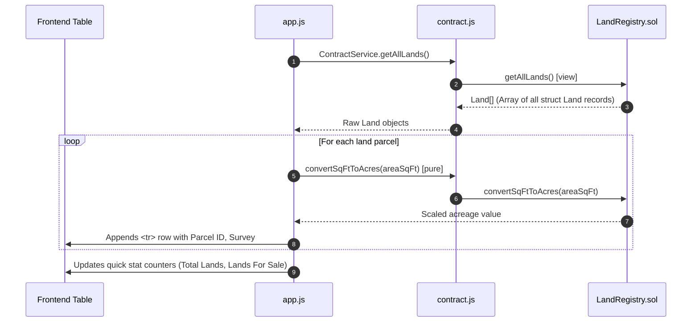
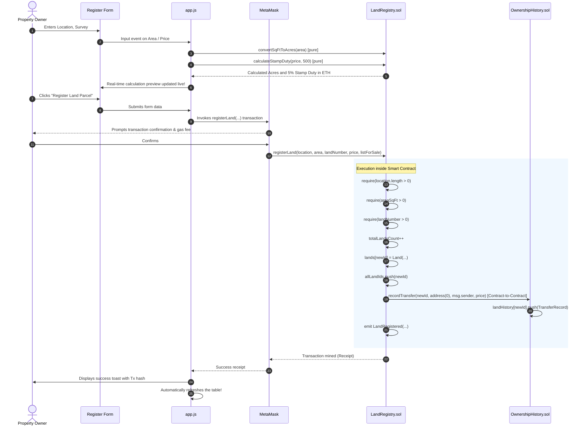
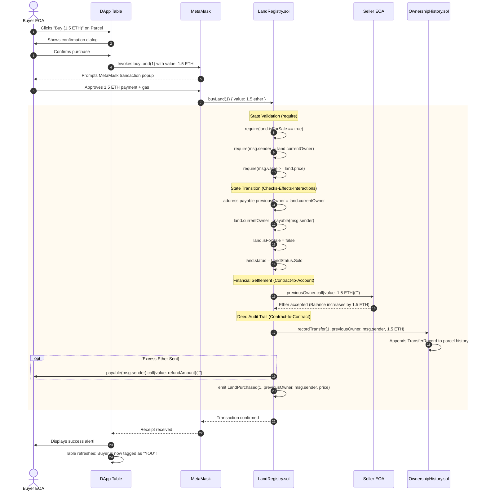
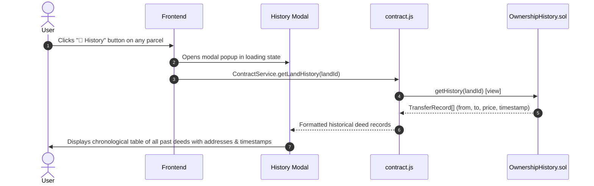

# 📖 Land Registry DApp - System Architecture & Workflow Guide

This document provides a comprehensive, step-by-step breakdown of how the **Blockchain Land Registry** operates, from low-level smart contract mechanics to the user interface.

---

## 🏛️ System Architecture Diagram

---

## 🔄 End-to-End Workflows

### 1. Wallet Connection & Network Synchronization Workflow
*(Satisfies Requirement 2: Connect Wallet)*

**Key Highlights:**
- **Zero-Friction Onboarding**: Automatically detects whether the user is on the local network (`0x539`) and prompts MetaMask to switch seamlessly.
- **Dynamic Event Handling**: Listens to `accountsChanged` and `chainChanged` events; switching accounts in MetaMask instantly updates the UI without page reload.

---

### 2. Land Parcels Table Querying Workflow
*(Satisfies Requirement 5: Table Function & Requirement 8: View Function)*

**Key Highlights:**
- **Batch Retrieval**: Rather than making individual RPC calls for each parcel ID, `getAllLands()` returns an array of structs in a single call, optimizing network performance.
- **Smart Ownership Detection**: The UI compares `land.currentOwner` with the connected account; if identical, it tags the parcel with a **`YOU`** badge and displays management actions (**Price**, **Delist**) rather than a **Buy** button.

---

### 3. Registering a New Land Parcel Workflow
*(Satisfies Requirement 3: One Function, Requirement 6: Contract-to-Contract, Requirement 7: `require`, Requirement 8: `pure`)*

**Key Highlights:**
- **Contract-to-Contract Initial Logging**: Upon creation, `LandRegistry` calls `OwnershipHistory.recordTransfer(...)` with `from: 0x0`, creating an immutable genesis deed for the parcel.
- **Live Pure Functions**: The form demonstrates `pure` functions before transaction submission, computing acreage and government stamp duty dynamically.

---

### 4. Buying Land & Ether Settlement Workflow
*(Satisfies Requirement 6: Contract-to-Account & Contract-to-Contract, Requirement 7: `require`)*

**Key Highlights:**
- **Contract-to-Account**: Ether moves from the buyer's wallet, through the contract, and directly into the seller's Externally Owned Account (`previousOwner.call{value: salePrice}("")`).
- **Reentrancy Protection**: State variables (`land.currentOwner`, `isForSale`) are updated *before* transferring Ether, adhering strictly to the **Checks-Effects-Interactions (CEI)** security pattern.
- **Contract-to-Contract Deed Logging**: Concurrently triggers `OwnershipHistory.recordTransfer(...)` to permanently log the deed change on-chain.

---

### 5. Viewing Immutable Deed Audit Trail Workflow
*(Satisfies Requirement 6: Contract-to-Contract Historical Query)*

**Key Highlights:**
- Demonstrates distributed separation of concerns: property market operations live in `LandRegistry.sol`, while historical transfer audits live in `OwnershipHistory.sol`.

---

## 🛡️ Security & Access Control Mechanics

| Modifier / Guard | Target Contract | Purpose | Protection Mechanism |
|---|---|---|---|
| `onlyContractOwner` | `LandRegistry.sol` | Admin operations (e.g. updating the history contract link) | `require(msg.sender == contractOwner, "Not authorized");` |
| `onlyLandOwner(uint256 _id)` | `LandRegistry.sol` | Listing parcel, updating price, delisting | `require(lands[_id].currentOwner == msg.sender, "Only land owner");` |
| `landExists(uint256 _id)` | `LandRegistry.sol` | Validates parcel existence | `require(lands[_id].id != 0, "Land parcel does not exist");` |
| `onlyAuthorized` | `OwnershipHistory.sol` | Prevents arbitrary modification of deed records | `require(msg.sender == registryContract || msg.sender == admin);` |
| Checks-Effects-Interactions | `LandRegistry.sol` | Prevents reentrancy during Ether transfer | State updated before `.call{value: ...}` external transfer |

---

## 🎯 Viva & Presentation Cheat-Sheet

When presenting or demonstrating this project, follow this roadmap to showcase all 9 requirements:

1. **Show Contracts (Req 1, 4, 7, 8)**:
   - Open [`contracts/LandRegistry.sol`](file:///contracts/LandRegistry.sol). Point to the **Constructor** at lines 77–82, **Modifiers** at lines 57–72, **pure functions** (`convertSqFtToAcres`, `calculateStampDuty`) at lines 235–251, and `require` statements in `buyLand` at lines 174–177.
2. **Show Contract-to-Contract (Req 6)**:
   - Point to line 189 in `LandRegistry.sol` where `historyContract.recordTransfer(...)` is called, and show the implementation in [`contracts/OwnershipHistory.sol`](file:///contracts/OwnershipHistory.sol).
3. **Show Contract-to-Account (Req 6)**:
   - Point to line 186 in `LandRegistry.sol` where Ether is forwarded to the seller via `previousOwner.call{value: salePrice}("")`.
4. **Show Wallet Connection (Req 2)**:
   - Show the green **`🟢 Connected`** badge, address, and live ETH balance in the top bar of the frontend.
5. **Show Table (Req 5)**:
   - Demonstrate the dynamic table in the browser with search, filters (**All Parcels**, **For Sale Only**, **My Parcels**), and the **`YOU`** ownership badge.
6. **Show Test Suite (Req 9)**:
   - In terminal, run `npm test` and show all **14 tests passing** with 100% green checkmarks.

